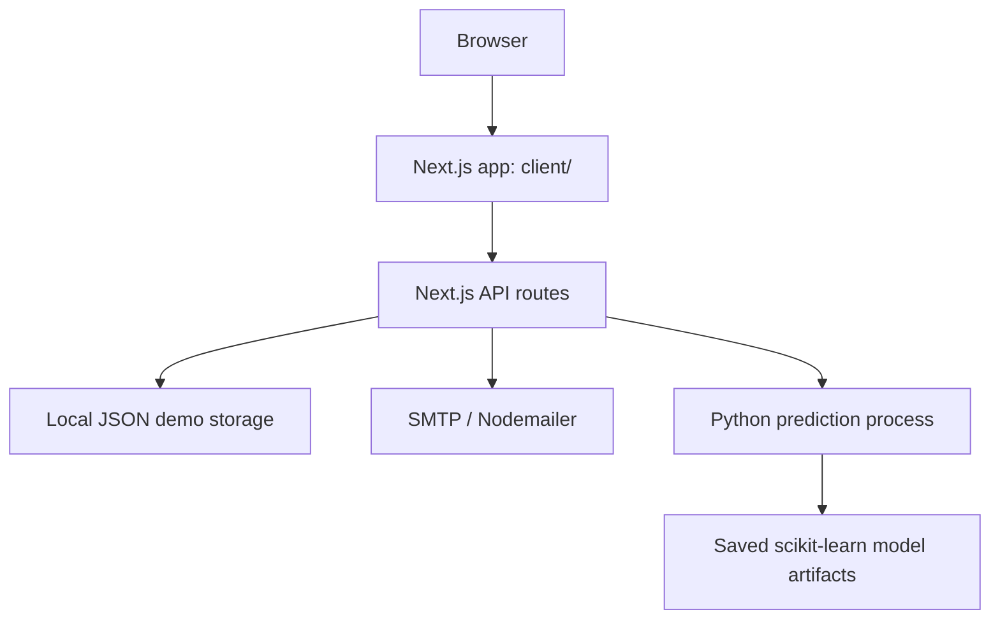

# IPO Matchmaker

An experimental web platform for exploring IPO discovery, investor-partnership workflows, portfolio views, and model-assisted listing-price predictions.

> **Project status: prototype.** This repository is useful for studying a full-stack product and ML integration, but it is not a live investment service. The IPO API currently returns fixture data, the listing-prediction models have not been independently validated, and the demo authentication uses file-backed local storage. Do not use it for investment decisions, real identity data, or production authentication.

## What it demonstrates

- **IPO discovery UI** — browse sample IPO records and inspect listing details.
- **Portfolio and analytics views** — dashboard components for holdings, performance, allocation, and prediction results.
- **Partnership workflows** — demo flows for requests, collaboration, and messages.
- **Email notifications** — Nodemailer-based notifications configured through environment variables.
- **ML integration** — Next.js API routes invoke a Python prediction script using saved model artifacts.
- **Reusable UI** — Next.js App Router, TypeScript, Tailwind CSS, and component-based UI.

## Architecture



| Path | Purpose |
|---|---|
| `client/app/` | Main Next.js App Router pages and API routes |
| `client/components/` | Dashboard, IPO, portfolio, partnership, and UI components |
| `client/lib/` | Email, API, notification, and application helpers |
| `client/.env.example` | Placeholder-only environment template |
| `server/src/ml/` | Python IPO prediction implementation |
| `server/model/` | Serialized model and imputer artifacts |
| `ML_PREDICTION_SYSTEM.md` | ML integration notes and known constraints |

**Architecture note:** `server/` currently contains a parallel Next.js application as well as the Python ML assets. The duplication is legacy architecture that should be consolidated before treating this as a production service. The client-side prediction route expects the Python environment and model files under `server/`.

## Run locally

### Requirements

- Node.js 20 or newer
- npm
- Python 3 (only needed for the prediction endpoint)

### Start the main app

```bash
cd client
cp .env.example .env.local
npm ci
npm run dev
```

Open [http://localhost:3000](http://localhost:3000).

For UI-only development, set `EMAIL_DISABLED=true` in `client/.env.local` so testing the app does not send email. Keep real credentials in the untracked local environment file or deployment secret manager—never in source code.

### Enable the Python prediction path

From the repository root:

```bash
cd server
python3 -m venv ml_env
source ml_env/bin/activate
pip install -r requirements.txt
```

Confirm the expected files exist before using the prediction endpoint:

- `server/src/ml/ipo_predictor.py`
- `server/model/imputer.pkl`
- `server/model/model_lg.pkl`
- `server/model/model_lp.pkl`

The prediction route depends on this local Python environment. It will not work in a fresh Node-only setup until the Python dependencies and artifacts are available.

## Development checks

The repository includes manual smoke-test scripts, including `test-ml-prediction.sh` and `test-email-system.sh`. Run them only after configuring the relevant local services and environment variables.

Before contributing, inspect the resulting diff and run the checks relevant to your changes. Automated CI and a clean, reproducible end-to-end test suite still need to be established; no passing build is claimed by this README.

## Security and data boundaries

- `client/.env.local` is local-only; use `client/.env.example` as a template.
- Runtime JSON stores are development/demo persistence, not a production database.
- Demo authentication must not be exposed to the public internet or used with real passwords, PANs, financial information, or personal data.
- Use a secret manager for deployment credentials and rotate any credential that may have been exposed.
- Predictions are experimental outputs, not financial advice; sample IPO records and model outputs may be stale or inaccurate.

## Current engineering priorities

1. Replace file-backed demo authentication with a secure, persistent identity system and password hashing.
2. Replace sample IPO records with a documented, validated data source.
3. Harden the Python process boundary and validate model inputs.
4. Consolidate the duplicated Next.js application structure.
5. Add CI for reproducible installation, lint/type checks, tests, and build verification.

## License

No license file is currently provided. Do not assume that this repository grants permission to reuse or redistribute the code.
